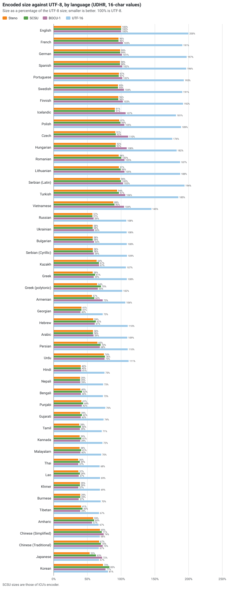

# Results at a Glance

These pages measure the Steno Encoding (Steno for short) for its intended use, stored values in a database or a key-value store, and beyond it. Every table and chart in this section is generated by the benchmark tool of the repository from its measurements; this page quotes them.

Steno, UTF-8, UTF-16 and BOCU-1 give one encoding per text, so their sizes are the same in every correct implementation; SCSU leaves choices to the encoder, and its sizes are those of ICU's encoder. Speeds are a property of an implementation: the headline speeds are those of the Rust reference implementation, labelled Steno (Rust), against native implementations of the alternatives, and each implementation's page has its own.

## Stored Values

**Over every group of values of up to 16 characters, in both corpora, the Steno Encoding is the smallest of the 13 codecs measured.** A group of values is all the values of one length in one corpus, such as the 16-character values of the UDHR in 47 languages; the 13 codecs are UTF-8, UTF-16, SCSU, BOCU-1 and UTF-8 compressed with four general compressors at two levels each. Over the UDHR in 47 languages, Steno takes 1.11 bytes per character on 16-character values, against 1.92 for UTF-8, 2.00 for UTF-16, 1.14 for SCSU and 1.17 for BOCU-1 ([Stored Values](stored.md)).

In pages, as a calculation from the measured sizes: 507 Cyrillic 16-character values fit in 8 KB in Steno against 299 in UTF-8, and 513 Indic values against 201.

## Working on the Bytes

**Comparing the Steno bytes of two values is many times as fast as decoding both first** ([Comparing Without Decoding](comparing.md)). Comparing UTF-8 bytes costs about the same as comparing Steno bytes; the gain is against formats that must be decoded to compare.

## Cost per Value

**Steno is encoded and decoded where text enters and leaves a store; inside it, the store works on the bytes** ([Cost per Value and Speed](speed.md)). The figures compare the Rust reference implementation with a validated UTF-8 copy, with a conversion from UTF-16 to UTF-8, and with ICU's SCSU and BOCU-1, all native code; [Implementations Side by Side](implementations.md) puts the implementations together.

## Beyond Stored Values

On paragraphs and whole documents a general compressor is the right tool: Brotli at level 11 takes 0.42 bytes per character over whole UDHR documents, against 1.05 for Steno. On values of up to 16 characters every compressor is larger than Steno and than UTF-8 ([Steno and General Compressors](../comparisons/compressors.md)).

## Trade-offs

**Steno is smaller than UTF-8, UTF-16, SCSU and BOCU-1 over every one of the 13 groups of values measured.** Of the 565 sets of values (one language or text at one length of value), UTF-8 is smaller in none, UTF-16 in 8, SCSU in 13 and BOCU-1 in 34. The exceptions have four causes, each with its reason in the design; [Trade-offs at a Glance](../comparisons/trade-offs.md) lists them all, with each alternative's page one click away.

## Pages in This Section

| Page | What it shows |
|---|---|
| [Stored Values](stored.md) | The size of short values by script, against UTF-8, UTF-16, SCSU and BOCU-1, and how many values fit in a page |
| [Comparing Without Decoding](comparing.md) | Comparing Steno bytes as they are, against decoding them first |
| [Cost per Value and Speed](speed.md) | Encoding and decoding against UTF-8, SCSU and BOCU-1, in native code |
| [Implementations Side by Side](implementations.md) | The implementations, each in its own language, on the same workloads |
| [ASCII Fast Paths](ascii.md) | Checking ASCII text and converting it to and from UTF-8 |
| [Encoded Size](encoded-size.md) and [Size by Language](size-udhr-16-char-values.md) | The full tables of all 13 codecs |
| [How the Numbers Were Measured](machine.md) | The corpora, the codecs, the machine, the method and the derived figures |

The comparison of Steno with general compressors on long documents is on [Steno and General Compressors](../comparisons/compressors.md), and the whole record on [Trade-offs at a Glance](../comparisons/trade-offs.md).

