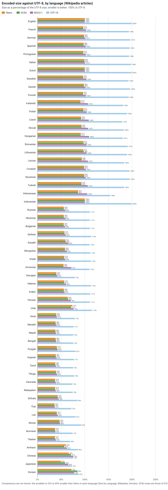

<!-- The tables are generated by the benchmark tool into Docs/benchmarks/sizes-by-language/wikipedia-each-article-a-value.md; regenerate them there, never edit them here. -->

[!include]

## Chart

## Related Pages

- [Trade-offs at a Glance](../comparisons/trade-offs.md) has the whole record, and the cause of each case where another codec is smaller.
- [How the Numbers Were Measured](machine.md) says how the values were made and what each codec is.

