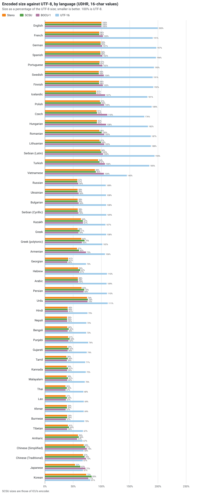

<!-- The content is generated by the benchmark tool into Docs/benchmarks/stored.md; regenerate it there, never edit it here. -->

[!include]

## Chart

## Related Pages

- The comparison pages put Steno against each of these encodings in turn: [UTF-8](../comparisons/utf-8.md), [UTF-16](../comparisons/utf-16.md), [SCSU](../comparisons/scsu.md) and [BOCU-1](../comparisons/bocu-1.md).
- [Trade-offs at a Glance](../comparisons/trade-offs.md) has the whole record at a glance, and the cause of each case where another encoding is smaller.

