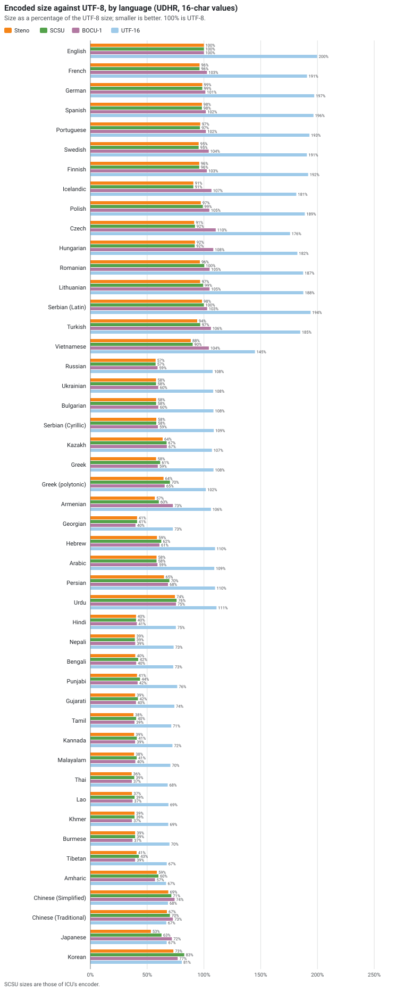

<div class="article">

# Why the Steno Encoding

The Steno Encoding (Steno for short) is a compact encoding of Unicode text whose bytes sort like the text. It was designed to be the ideal per-value compression encoding for databases and key-value stores, which can sort, compare, range-scan and prefix-match Steno bytes as plain bytes, without decoding them. This page makes the case for that use, with the measured numbers.

Steno is designed to be the better choice wherever you would otherwise reach for SCSU or BOCU-1, the two Unicode compression schemes. It is smaller than both over every group of values measured, and it is the only one of the three with all five properties that a store needs: bytes that sort like the text, prefixes that stay prefixes, one encoding per text, no 00 byte, and line feeds, tabs and spaces that can be found in the bytes without decoding. [Steno or SCSU?](../comparisons/scsu.md) and [Steno or BOCU-1?](../comparisons/bocu-1.md) compare them in full.

### Intended Workload

A database or a key-value store keeps text as many short **values**, each one text that is encoded on its own: names, titles, keys, fields. It compares and sorts them far more often than it shows them to anyone, so most of its work is on the stored bytes, not on the text. The Steno Encoding is built for exactly that:

- each value is encoded on its own, with no header, so a 4-character value stays small;
- over every group of values measured, the bytes are the smallest of the per-value encodings: about 1 byte per character for alphabets such as Greek, Cyrillic, Arabic, Hindi and Thai, and about 2 for Chinese, Japanese and Korean;
- the bytes keep everything a store needs to work on them directly: the order, the prefixes, one encoding per text, no 00 byte, and no line feed, tab or space byte inside another character.

## What a Store Can Do with the Bytes

| Property | What the format guarantees | What a store does with it |
|---|---|---|
| Order | Two encodings compared as unsigned bytes are in the order of their texts compared code point by code point (by the Unicode numbers of their characters) | Sorts, compares and range-scans encoded values as plain bytes |
| Prefixes | The encoding of a prefix of a text is a prefix of the encoding of the text | Finds every value that starts with some text; compresses sorted keys by their common prefix |
| One encoding per text (the specification calls it uniqueness) | A text has exactly one encoding | Tests equality and hashes on the bytes |
| No zero byte | The byte 00 never occurs, even for U+0000 | Ends a field with 00 inside a composite key |
| No byte below 08 inside a character | The bytes 01 to 07 only ever start a character: each is a control character or the space, so 03 is always a line feed, 02 a tab, 05 a carriage return and 07 a space | Splits encoded text on line feeds, tabs and spaces as bytes; keeps values in line- or tab-delimited data |

The examples below show the bytes of values in hexadecimal.

#### Order

```text
"Zug"      41 5C 4E
"Zürich"   41 A3 59 50 4A 4F
```

The texts first differ at "u" (U+0075) and "ü" (U+00FC), and the bytes first differ at `5C` and `A3`, so "Zug" comes first both ways. The order is code point order (the order of the characters' Unicode numbers), the same as the order of UTF-8 and UTF-32 bytes.

#### Prefixes

```text
"Mül"      34 A3 53
"Müller"   34 A3 53 53 4C 59
```

The bytes of "Mül" start the bytes of "Müller". In a sorted index, the values that start with "Mül" sit in one run, which starts where the bytes of "Mül" would be.

#### One Encoding per Text

Equal bytes mean equal text, and different bytes mean different text, so a hash of the bytes is a hash of the text.

#### No Zero Byte

```text
"Ng" + 00 + "Wei"         35 4E 00 3E 4C 50
"Nguyen" + 00 + "Anh"     35 4E 5C 60 4C 55 00 28 55 4F
```

Two fields joined with a 00 byte sort field by field: 00 is smaller than every byte of an encoding, so "Ng" comes before "Nguyen" whatever follows, and the 00 marks where to split the key again.

#### No Byte Below 08 Inside a Character

```text
"Москва" + tab + "Киев" + line feed + "Лондон" + tab + "Париж"

E9 F4 A8 AB A4 9C 9A 02 84 A2 9F 9C 03 85 A8 A7 9E A8 A7 02 89 9A AA A2 A0
```

The one `03` is the line feed and the two `02` bytes are the tabs; no other character contains them. So a program finds the lines and the fields of this text in its bytes, without decoding it. A line cannot be decoded on its own, because the bytes of each character depend on the text before it; an application that wants to decode each line on its own encodes each line as a value of its own ([Working with Encoded Values](encoded-values.md#line-feeds-tabs-and-spaces)).

## How Small It Is

On short values, of up to 16 characters, the Steno Encoding is the smallest of all 13 codecs measured: UTF-8, UTF-16, SCSU, BOCU-1, and UTF-8 compressed with Deflate, Brotli, LZ4 or Zstandard at two levels each. Over the UDHR in 47 languages cut into 16-character values, it takes 1.11 bytes per character, against 1.92 for UTF-8.

The saving against UTF-8 depends on the script. On those 16-character values, UTF-8 is 70% larger than Steno in Cyrillic, 73% in Greek, 50% in Arabic script, 155% in the Indic scripts, 174% in Thai and Lao, 88% in Japanese, 47% in Chinese and 37% in Korean. In Latin script, which UTF-8 already writes in about 1 byte per character, the two are close: UTF-8 is 4% larger.



Where it can, the Steno Encoding writes each letter in 1 byte. For this it keeps a small state with a **window**: a run of up to 128 code points that usually holds the letters of one script, and whose code points take 1 byte. When the text changes script, the window follows it, and the first character in the new script takes 2 to 4 bytes. Chinese ideographs and Korean syllables take 2 bytes each after the first. [Stored Values](../benchmarks/stored.md) has the sizes by script against every per-value encoding.

## Working on the Bytes

- **No decoding to compare.** A store compares the Steno bytes of two values as they are. Formats that keep no order, such as SCSU or compressed text, must decode both first, which takes many times as long in the .NET measurements; UTF-8 bytes compare about as fast as Steno bytes ([Comparing Without Decoding](../benchmarks/comparing.md)).
- **It drops into existing stores.** A store that sorts keys as unsigned bytes, as many ordered key-value stores do by default, keeps Steno keys in the order of their text with no comparator of its own and no change inside the store. The encoder sits at the edges, where text enters and leaves.
- **Text that is already UTF-8 converts directly.** The .NET, Rust, C and Go reference implementations convert between UTF-8 and Steno without an intermediate string, and ASCII text takes a vectorized fast path in .NET ([ASCII Fast Paths](../benchmarks/ascii.md)).

## Open and Implemented

The Steno Encoding is specified in [Steno Encoding, version 1](../reference/specification.md), with a test vector file that every implementation can check itself against. Anyone may implement it, for any purpose, without permission or payment. The format is frozen: bytes written by any correct implementation decode to the same text with any other, now and later. Reference implementations exist in [.NET](../implementations/dotnet.md), [Rust](../implementations/rust.md), [C](../implementations/c.md), [Go](../implementations/go.md), [Java](../implementations/java.md), [TypeScript](../implementations/typescript.md) and [Python](../implementations/python.md), and each passes the full test vector file.

## Right Tool for Each Job

The Steno Encoding is built for stored values. For other jobs, other tools are the right choice; [Trade-offs at a Glance](../comparisons/trade-offs.md) has the whole record, and each comparison page shows both sides with the numbers.

| Job | Best choice | Why |
|---|---|---|
| Text values and index keys in a database or key-value store | **Steno** | The smallest of the 13 codecs measured over every group of values of up to 16 characters, and a store compares, sorts, prefix-matches and hashes the bytes without decoding. See [Steno or BOCU-1?](../comparisons/bocu-1.md) and [Steno or SCSU?](../comparisons/scsu.md) for the closest alternatives. |
| Long documents that are stored and read back whole | A general compressor | It finds repetition across the whole text, and order does not matter there: Brotli at level 11 takes 0.42 bytes per character over whole UDHR documents, against 1.05 for Steno. See [Steno and General Compressors](../comparisons/compressors.md). |
| Text exchanged with other systems | UTF-8 | Every system reads it. See [Steno or UTF-8?](../comparisons/utf-8.md). |
| ASCII-only data, where CPU time matters more than size | UTF-8 | The same size, and it transcodes short values faster. See [Steno or UTF-8?](../comparisons/utf-8.md). |
| Text processed in memory | Your language's own strings | No transcoding at all. See [Steno or UTF-16?](../comparisons/utf-16.md). |
| Sorting for people | A collation, such as `CompareInfo` in .NET or `Collator` in Java | Code point order is not the order of any language. |

## Next Steps

- [Storing Steno Values](storing-values.md) - How to integrate the encoding into a store, and why it works the way it does.
- [Implementations](../implementations/dotnet.md) - Pick your language and start.
- [Trade-offs at a Glance](../comparisons/trade-offs.md) - The whole record against UTF-8, UTF-16, SCSU, BOCU-1 and general compressors, with a page for each.
- [Results at a Glance](../benchmarks/overview.md) - Every measurement.

</div>
