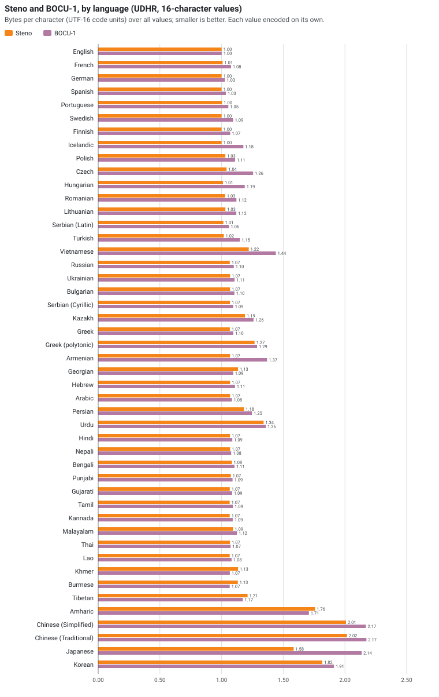

## Size, Head to Head

**Steno is smaller than BOCU-1 over every one of the 13 groups of values (BOCU-1 is 1% to 12% larger than Steno), and in 506 of the 565 sets of values; the two are tied (within 0.5%) in 25, and BOCU-1 is smaller in 34.**

A set of values is one language or text at one length of value, such as Russian in 16-character UDHR values; a group of values is all the sets of one length in one corpus. Bytes per character, counting characters as UTF-16 code units (an emoji counts as 2); smaller is better. Each value is encoded on its own, as a database stores a field.

By group of values:

| Group | **Steno** | BOCU-1 | BOCU-1 against Steno (+ is larger) |
|---|--:|--:|--:|
| UDHR, 4-char values | 1.26 | 1.28 | +1% |
| UDHR, 8-char values | 1.16 | 1.20 | +4% |
| UDHR, 16-char values | 1.11 | 1.17 | +5% |
| UDHR, paragraphs | 1.06 | 1.13 | +7% |
| UDHR, documents | 1.05 | 1.13 | +8% |
| Mixed content, lines | 1.17 | 1.30 | +11% |
| Mixed content, documents | 1.16 | 1.30 | +12% |
| Names and UI strings | 1.15 | 1.25 | +9% |
| Wikipedia, 4-char values | 1.18 | 1.23 | +4% |
| Wikipedia, 8-char values | 1.11 | 1.17 | +5% |
| Wikipedia, 16-char values | 1.08 | 1.14 | +6% |
| Wikipedia, paragraphs | 1.04 | 1.12 | +7% |
| Wikipedia, articles | 1.04 | 1.12 | +8% |

By script, over the UDHR in 47 languages:

| Script | **Steno**, 4 chars | BOCU-1, 4 chars | BOCU-1 against Steno, 4 chars | **Steno**, 16 chars | BOCU-1, 16 chars | BOCU-1 against Steno, 16 chars |
|---|--:|--:|--:|--:|--:|--:|
| Latin | 1.01 | 1.09 | +8% | 1.01 | 1.10 | +9% |
| Vietnamese | 1.32 | 1.43 | +9% | 1.22 | 1.44 | +18% |
| Cyrillic | 1.29 | 1.32 | +2% | 1.09 | 1.13 | +4% |
| Greek | 1.27 | 1.29 | +2% | 1.07 | 1.10 | +3% |
| Greek (polytonic) | 1.53 | 1.44 | −6% | 1.27 | 1.29 | +2% |
| Armenian | 1.27 | 1.51 | +19% | 1.07 | 1.37 | +28% |
| Georgian | 1.53 | 1.28 | −16% | 1.13 | 1.09 | −3% |
| Hebrew | 1.27 | 1.30 | +2% | 1.07 | 1.11 | +4% |
| Arabic script | 1.41 | 1.42 | +0.7% | 1.21 | 1.24 | +3% |
| Indic scripts | 1.28 | 1.29 | +1% | 1.07 | 1.09 | +2% |
| Thai and Lao | 1.25 | 1.26 | +0.5% | 1.07 | 1.08 | +1% |
| Khmer | 1.52 | 1.26 | −17% | 1.13 | 1.07 | −6% |
| Burmese | 1.52 | 1.26 | −17% | 1.13 | 1.07 | −6% |
| Tibetan | 1.59 | 1.34 | −16% | 1.21 | 1.17 | −3% |
| Ethiopic (Amharic) | 2.02 | 1.77 | −13% | 1.76 | 1.71 | −3% |
| Chinese | 2.21 | 2.32 | +5% | 2.01 | 2.17 | +8% |
| Japanese | 1.94 | 2.30 | +18% | 1.58 | 2.14 | +35% |
| Korean | 2.10 | 2.17 | +3% | 1.82 | 1.91 | +5% |

### Where BOCU-1 Is Smaller

BOCU-1 is smaller than Steno by 0.5% or more in 34 of the 565 sets of values, for one reason:

| Cause | Sets of values | By up to | Why the design accepts this |
|---|---|--:|---|
| The first letter of a script above U+0EFF takes 3 bytes | Greek (polytonic) (UDHR: 4 and 8 chars), Georgian (UDHR: 4, 8 and 16 chars; Wikipedia: 4, 8 and 16 chars), Khmer (UDHR: 4, 8, 16 and paragraphs; Wikipedia: 4, 8 and 16 chars), Burmese (UDHR: 4, 8, 16 and paragraphs; Wikipedia: 4, 8 and 16 chars), Tibetan (UDHR: 4, 8 and 16 chars; Wikipedia: 4, 8 and 16 chars) and Amharic (UDHR: 4, 8 and 16 chars; Wikipedia: 4, 8 and 16 chars) | 17% | Every value starts ready for ASCII and the Latin letters, which take 1 byte, and for the scripts up to U+0EFF, whose first letter takes 2: Greek, Cyrillic, Armenian, Hebrew, Arabic, the Indic scripts, Thai and Lao. There is no room left in that starting state to give a 2-byte first letter to the scripts above U+0EFF as well, such as Georgian, Khmer, Burmese, Tibetan and Ethiopic. The cost is one byte, once per value; from the second letter on, these scripts take 1 byte per letter too. ([§6.6](../articles/reference/specification.md#66-the-initial-layout), [§13.6](../articles/reference/specification.md#136-every-layout-fits)) |

The languages where BOCU-1 is smaller at some length of value account for about 1% of the speakers of the large languages measured ([how this is counted](../articles/comparisons/trade-offs.md#weighted-by-speakers)).

## Values per 8 KB Page

How many 16-character values fit in 8 KB, by script, over the UDHR in 47 languages; more is better. Calculated from the measured sizes ([how](../articles/benchmarks/machine.md#derived-figures)).

| Script | **Steno** | BOCU-1 | Steno fits more (+) or fewer (−) |
|---|--:|--:|--:|
| Latin | 544 | 500 | +9% |
| Vietnamese | 461 | 391 | +18% |
| Cyrillic | 507 | 489 | +4% |
| Greek | 518 | 504 | +3% |
| Greek (polytonic) | 434 | 427 | +2% |
| Armenian | 518 | 404 | +28% |
| Georgian | 483 | 500 | −3% |
| Hebrew | 536 | 517 | +4% |
| Arabic script | 465 | 453 | +3% |
| Indic scripts | 513 | 503 | +2% |
| Thai and Lao | 515 | 510 | +1% |
| Khmer | 483 | 514 | −6% |
| Burmese | 476 | 505 | −6% |
| Tibetan | 448 | 463 | −3% |
| Ethiopic (Amharic) | 328 | 338 | −3% |
| Chinese | 332 | 307 | +8% |
| Japanese | 387 | 287 | +35% |
| Korean | 338 | 321 | +5% |
