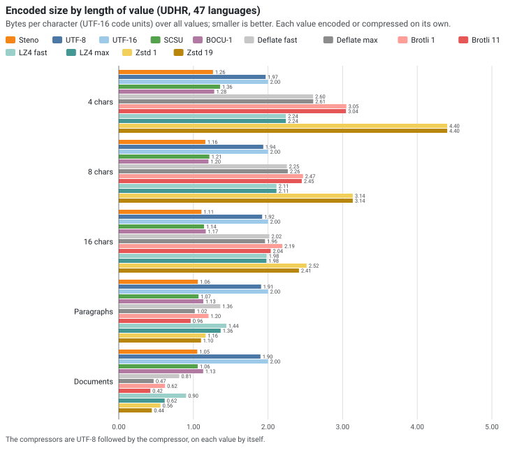

## Size by Length of Value

**Every compressor is larger than Steno over each group of values of up to 16 characters, over the mixed lines and over the names and UI strings. Over paragraphs and whole documents the strongest are smaller, by up to 60% over a group of values.** At least one compressor is smaller than Steno in 212 of the 565 sets of values. A set of values is one language or text at one length of value, such as Russian in 16-character UDHR values; a group of values is all the sets of one length in one corpus. Bytes per character, counting characters as UTF-16 code units (an emoji counts as 2); smaller is better. Each value is encoded on its own, as a database stores a field. In parentheses is the size against Steno: + is larger than Steno, − is smaller. Each value is compressed on its own, from its UTF-8, with nothing shared between values.

At the strongest levels:

| Group | **Steno** | UTF-8 | Deflate max | Brotli 11 | LZ4 max | Zstd 19 |
|---|--:|--:|--:|--:|--:|--:|
| UDHR, 4-char values | 1.26 | 1.97 (+56%) | 2.61 (+106%) | 3.04 (+141%) | 2.24 (+77%) | 4.40 (+248%) |
| UDHR, 8-char values | 1.16 | 1.94 (+67%) | 2.26 (+95%) | 2.45 (+111%) | 2.11 (+82%) | 3.14 (+170%) |
| UDHR, 16-char values | 1.11 | 1.92 (+73%) | 1.96 (+77%) | 2.04 (+84%) | 1.98 (+79%) | 2.41 (+118%) |
| UDHR, paragraphs | 1.06 | 1.91 (+80%) | 1.02 (−4%) | 0.96 (−9%) | 1.36 (+29%) | 1.10 (+4%) |
| UDHR, documents | 1.05 | 1.90 (+81%) | 0.47 (−56%) | 0.42 (−60%) | 0.62 (−42%) | 0.44 (−58%) |
| Mixed content, lines | 1.17 | 1.66 (+42%) | 1.55 (+32%) | 1.48 (+26%) | 1.63 (+39%) | 1.68 (+43%) |
| Mixed content, documents | 1.16 | 1.65 (+42%) | 1.04 (−10%) | 0.89 (−24%) | 1.35 (+16%) | 1.08 (−7%) |
| Names and UI strings | 1.15 | 1.67 (+45%) | 1.70 (+47%) | 1.75 (+52%) | 1.71 (+49%) | 2.06 (+78%) |
| Wikipedia, 4-char values | 1.18 | 1.63 (+38%) | 2.23 (+89%) | 2.71 (+130%) | 1.90 (+61%) | 4.07 (+244%) |
| Wikipedia, 8-char values | 1.11 | 1.61 (+45%) | 1.93 (+73%) | 2.12 (+91%) | 1.77 (+60%) | 2.79 (+151%) |
| Wikipedia, 16-char values | 1.08 | 1.60 (+48%) | 1.70 (+58%) | 1.80 (+67%) | 1.70 (+58%) | 2.14 (+99%) |
| Wikipedia, paragraphs | 1.04 | 1.59 (+52%) | 0.83 (−21%) | 0.77 (−26%) | 1.12 (+8%) | 0.88 (−16%) |
| Wikipedia, articles | 1.04 | 1.58 (+52%) | 0.49 (−53%) | 0.44 (−58%) | 0.63 (−40%) | 0.47 (−55%) |

At the fastest levels:

| Group | **Steno** | UTF-8 | Deflate fast | Brotli 1 | LZ4 fast | Zstd 1 |
|---|--:|--:|--:|--:|--:|--:|
| UDHR, 4-char values | 1.26 | 1.97 (+56%) | 2.60 (+106%) | 3.05 (+141%) | 2.24 (+77%) | 4.40 (+248%) |
| UDHR, 8-char values | 1.16 | 1.94 (+67%) | 2.25 (+94%) | 2.47 (+113%) | 2.11 (+82%) | 3.14 (+170%) |
| UDHR, 16-char values | 1.11 | 1.92 (+73%) | 2.02 (+82%) | 2.19 (+98%) | 1.98 (+79%) | 2.52 (+127%) |
| UDHR, paragraphs | 1.06 | 1.91 (+80%) | 1.36 (+28%) | 1.20 (+14%) | 1.44 (+36%) | 1.16 (+10%) |
| UDHR, documents | 1.05 | 1.90 (+81%) | 0.81 (−23%) | 0.62 (−41%) | 0.90 (−14%) | 0.56 (−47%) |
| Mixed content, lines | 1.17 | 1.66 (+42%) | 1.65 (+41%) | 1.71 (+46%) | 1.63 (+39%) | 1.72 (+47%) |
| Mixed content, documents | 1.16 | 1.65 (+42%) | 1.35 (+16%) | 1.17 (+0.6%) | 1.39 (+20%) | 1.14 (−2%) |
| Names and UI strings | 1.15 | 1.67 (+45%) | 1.76 (+53%) | 1.88 (+63%) | 1.71 (+49%) | 2.11 (+83%) |
| Wikipedia, 4-char values | 1.18 | 1.63 (+38%) | 2.23 (+89%) | 2.71 (+130%) | 1.90 (+61%) | 4.07 (+244%) |
| Wikipedia, 8-char values | 1.11 | 1.61 (+45%) | 1.92 (+73%) | 2.13 (+92%) | 1.77 (+60%) | 2.79 (+151%) |
| Wikipedia, 16-char values | 1.08 | 1.60 (+48%) | 1.74 (+62%) | 1.86 (+73%) | 1.70 (+58%) | 2.19 (+103%) |
| Wikipedia, paragraphs | 1.04 | 1.59 (+52%) | 1.13 (+8%) | 0.96 (−8%) | 1.19 (+14%) | 0.92 (−12%) |
| Wikipedia, articles | 1.04 | 1.58 (+52%) | 0.80 (−23%) | 0.60 (−42%) | 0.86 (−17%) | 0.57 (−46%) |

The compressors are smaller over five of the 13 groups: UDHR, paragraphs; UDHR, documents; Mixed content, documents; Wikipedia, paragraphs; Wikipedia, articles.
