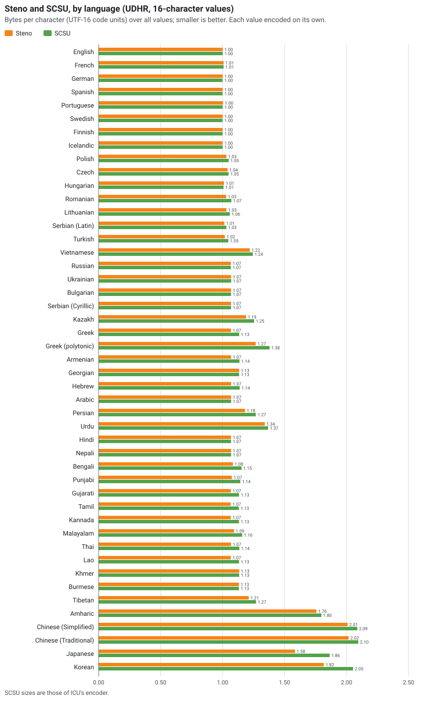

## Size, Head to Head

**Steno is smaller than SCSU over every one of the 13 groups of values (SCSU is 0.6% to 7% larger than Steno), and in 271 of the 565 sets of values; the two are tied (within 0.5%) in 281, and SCSU is smaller in 13.**

A set of values is one language or text at one length of value, such as Russian in 16-character UDHR values; a group of values is all the sets of one length in one corpus. Bytes per character, counting characters as UTF-16 code units (an emoji counts as 2); smaller is better. Each value is encoded on its own, as a database stores a field. SCSU sizes are those of ICU's encoder; another SCSU encoder can give other sizes.

By group of values:

| Group | **Steno** | SCSU | SCSU against Steno (+ is larger) |
|---|--:|--:|--:|
| UDHR, 4-char values | 1.26 | 1.36 | +7% |
| UDHR, 8-char values | 1.16 | 1.21 | +5% |
| UDHR, 16-char values | 1.11 | 1.14 | +3% |
| UDHR, paragraphs | 1.06 | 1.07 | +0.9% |
| UDHR, documents | 1.05 | 1.06 | +0.6% |
| Mixed content, lines | 1.17 | 1.24 | +6% |
| Mixed content, documents | 1.16 | 1.22 | +6% |
| Names and UI strings | 1.15 | 1.18 | +2% |
| Wikipedia, 4-char values | 1.18 | 1.24 | +5% |
| Wikipedia, 8-char values | 1.11 | 1.15 | +3% |
| Wikipedia, 16-char values | 1.08 | 1.10 | +2% |
| Wikipedia, paragraphs | 1.04 | 1.05 | +1% |
| Wikipedia, articles | 1.04 | 1.05 | +1% |

By script, over the UDHR in 47 languages:

| Script | **Steno**, 4 chars | SCSU, 4 chars | SCSU against Steno, 4 chars | **Steno**, 16 chars | SCSU, 16 chars | SCSU against Steno, 16 chars |
|---|--:|--:|--:|--:|--:|--:|
| Latin | 1.01 | 1.02 | +1% | 1.01 | 1.02 | +0.9% |
| Vietnamese | 1.32 | 1.36 | +3% | 1.22 | 1.24 | +2% |
| Cyrillic | 1.29 | 1.31 | +2% | 1.09 | 1.11 | +1% |
| Greek | 1.27 | 1.54 | +21% | 1.07 | 1.13 | +6% |
| Greek (polytonic) | 1.53 | 1.81 | +18% | 1.27 | 1.38 | +9% |
| Armenian | 1.27 | 1.54 | +21% | 1.07 | 1.14 | +6% |
| Georgian | 1.53 | 1.53 | 0% | 1.13 | 1.13 | 0% |
| Hebrew | 1.27 | 1.55 | +21% | 1.07 | 1.14 | +6% |
| Arabic script | 1.41 | 1.51 | +7% | 1.21 | 1.25 | +3% |
| Indic scripts | 1.28 | 1.48 | +16% | 1.07 | 1.12 | +5% |
| Thai and Lao | 1.25 | 1.51 | +20% | 1.07 | 1.13 | +6% |
| Khmer | 1.52 | 1.52 | 0% | 1.13 | 1.13 | 0% |
| Burmese | 1.52 | 1.52 | 0% | 1.13 | 1.13 | 0% |
| Tibetan | 1.59 | 1.66 | +4% | 1.21 | 1.27 | +5% |
| Ethiopic (Amharic) | 2.02 | 2.38 | +18% | 1.76 | 1.80 | +2% |
| Chinese | 2.21 | 2.27 | +3% | 2.01 | 2.09 | +4% |
| Japanese | 1.94 | 2.04 | +5% | 1.58 | 1.86 | +18% |
| Korean | 2.10 | 2.25 | +7% | 1.82 | 2.05 | +13% |

### Where SCSU Is Smaller

SCSU is smaller than Steno by 0.5% or more in 13 of the 565 sets of values, for three reasons:

| Cause | Sets of values | By up to | Why the design accepts this |
|---|---|--:|---|
| The script spans several windows (runs of up to 128 code points whose characters take 1 byte) | Urdu (UDHR: paragraphs and documents; Wikipedia: paragraphs and articles) and Amharic (UDHR: paragraphs and documents; Wikipedia: paragraphs and articles) | 9% | The Steno Encoding moves its window by itself as the text moves, with no tag bytes; that is what keeps its bytes in the order of the text, with one encoding per text. A script that spans more than one window, such as Ethiopic or the Arabic letters of Urdu, makes the window move often, and each move costs a byte or two. SCSU places tag bytes where its encoder chooses, which is how it wins here and why its bytes keep neither the order nor one encoding per text. ([§4](../articles/reference/specification.md#4-windows), [§7](../articles/reference/specification.md#7-state-update)) |
| Punctuation and symbols outside the letters' window | English with typographic punctuation (Mixed content: lines and documents), Spanish chat with emoji (Mixed content: documents) and Math and science notation (Mixed content: documents) | 1% | Dashes, quotation marks and currency signs take 2 bytes without moving the window away from the text's letters, so the text after them stays at 1 byte per letter; other symbols, such as arrows and emoji, take 3. ([§6.2](../articles/reference/specification.md#62-pieces)) |
| The first ideograph, kana or syllable of a value takes 3 bytes | Japanese (Wikipedia: 4 chars) | 0.5% | Every value starts ready for Latin text. The first ideograph, kana or Hangul syllable takes 3 bytes and switches the value to Chinese, Japanese or Korean text; after that, ideographs and syllables take 2 bytes and kana 1. That switch is what gives Japanese 1.58 bytes per character on 16-character UDHR values, against 2.00 in UTF-16 and 2.97 in UTF-8. ([§6.2](../articles/reference/specification.md#62-pieces), [§7](../articles/reference/specification.md#7-state-update)) |

The languages where SCSU is smaller at some length of value account for about 6% of the speakers of the large languages measured ([how this is counted](../articles/comparisons/trade-offs.md#weighted-by-speakers)).

## Values per 8 KB Page

How many 16-character values fit in 8 KB, by script, over the UDHR in 47 languages; more is better. Calculated from the measured sizes ([how](../articles/benchmarks/machine.md#derived-figures)).

| Script | **Steno** | SCSU | Steno fits more (+) or fewer (−) |
|---|--:|--:|--:|
| Latin | 544 | 539 | +0.9% |
| Vietnamese | 461 | 452 | +2% |
| Cyrillic | 507 | 501 | +1% |
| Greek | 518 | 487 | +6% |
| Greek (polytonic) | 434 | 399 | +9% |
| Armenian | 518 | 487 | +6% |
| Georgian | 483 | 483 | 0.0% |
| Hebrew | 536 | 504 | +6% |
| Arabic script | 465 | 451 | +3% |
| Indic scripts | 513 | 490 | +5% |
| Thai and Lao | 515 | 485 | +6% |
| Khmer | 483 | 483 | 0.0% |
| Burmese | 476 | 476 | 0.0% |
| Tibetan | 448 | 427 | +5% |
| Ethiopic (Amharic) | 328 | 321 | +2% |
| Chinese | 332 | 319 | +4% |
| Japanese | 387 | 329 | +18% |
| Korean | 338 | 299 | +13% |
