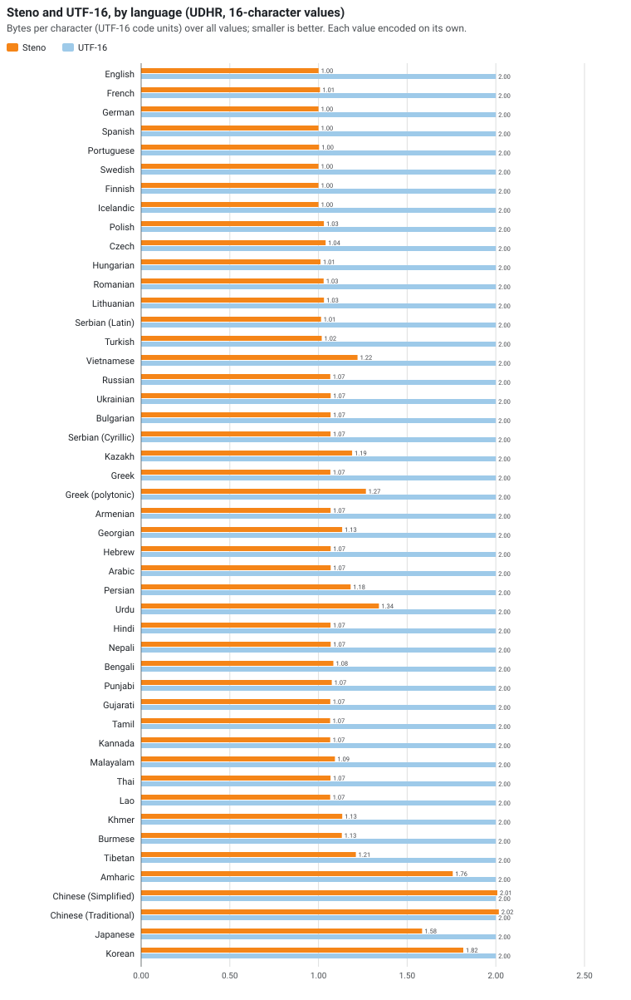

## Size, Head to Head

**Steno is smaller than UTF-16 over every one of the 13 groups of values (UTF-16 is 58% to 92% larger than Steno), and in 555 of the 565 sets of values; the two are tied (within 0.5%) in 2, and UTF-16 is smaller in 8.**

A set of values is one language or text at one length of value, such as Russian in 16-character UDHR values; a group of values is all the sets of one length in one corpus. Bytes per character, counting characters as UTF-16 code units (an emoji counts as 2); smaller is better. Each value is encoded on its own, as a database stores a field.

By group of values:

| Group | **Steno** | UTF-16 | UTF-16 against Steno (+ is larger) |
|---|--:|--:|--:|
| UDHR, 4-char values | 1.26 | 2.00 | +58% |
| UDHR, 8-char values | 1.16 | 2.00 | +72% |
| UDHR, 16-char values | 1.11 | 2.00 | +80% |
| UDHR, paragraphs | 1.06 | 2.00 | +89% |
| UDHR, documents | 1.05 | 2.00 | +90% |
| Mixed content, lines | 1.17 | 2.00 | +70% |
| Mixed content, documents | 1.16 | 2.00 | +72% |
| Names and UI strings | 1.15 | 2.00 | +74% |
| Wikipedia, 4-char values | 1.18 | 2.00 | +69% |
| Wikipedia, 8-char values | 1.11 | 2.00 | +80% |
| Wikipedia, 16-char values | 1.08 | 2.00 | +86% |
| Wikipedia, paragraphs | 1.04 | 2.00 | +92% |
| Wikipedia, articles | 1.04 | 2.00 | +92% |

By script, over the UDHR in 47 languages:

| Script | **Steno**, 4 chars | UTF-16, 4 chars | UTF-16 against Steno, 4 chars | **Steno**, 16 chars | UTF-16, 16 chars | UTF-16 against Steno, 16 chars |
|---|--:|--:|--:|--:|--:|--:|
| Latin | 1.01 | 2.00 | +98% | 1.01 | 2.00 | +98% |
| Vietnamese | 1.32 | 2.00 | +52% | 1.22 | 2.00 | +64% |
| Cyrillic | 1.29 | 2.00 | +55% | 1.09 | 2.00 | +83% |
| Greek | 1.27 | 2.00 | +57% | 1.07 | 2.00 | +87% |
| Greek (polytonic) | 1.53 | 2.00 | +31% | 1.27 | 2.00 | +58% |
| Armenian | 1.27 | 2.00 | +58% | 1.07 | 2.00 | +87% |
| Georgian | 1.53 | 2.00 | +31% | 1.13 | 2.00 | +76% |
| Hebrew | 1.27 | 2.00 | +57% | 1.07 | 2.00 | +87% |
| Arabic script | 1.41 | 2.00 | +42% | 1.21 | 2.00 | +65% |
| Indic scripts | 1.28 | 2.00 | +57% | 1.07 | 2.00 | +86% |
| Thai and Lao | 1.25 | 2.00 | +59% | 1.07 | 2.00 | +87% |
| Khmer | 1.52 | 2.00 | +32% | 1.13 | 2.00 | +76% |
| Burmese | 1.52 | 2.00 | +31% | 1.13 | 2.00 | +77% |
| Tibetan | 1.59 | 2.00 | +26% | 1.21 | 2.00 | +65% |
| Ethiopic (Amharic) | 2.02 | 2.00 | −1% | 1.76 | 2.00 | +14% |
| Chinese | 2.21 | 2.00 | −9% | 2.01 | 2.00 | −0.6% |
| Japanese | 1.94 | 2.00 | +3% | 1.58 | 2.00 | +26% |
| Korean | 2.10 | 2.00 | −5% | 1.82 | 2.00 | +10% |

### Where UTF-16 Is Smaller

UTF-16 is smaller than Steno by 0.5% or more in 8 of the 565 sets of values, for two reasons:

| Cause | Sets of values | By up to | Why the design accepts this |
|---|---|--:|---|
| The first letter of a script above U+0EFF takes 3 bytes | Amharic (UDHR: 4 chars) | 1% | Every value starts ready for ASCII and the Latin letters, which take 1 byte, and for the scripts up to U+0EFF, whose first letter takes 2: Greek, Cyrillic, Armenian, Hebrew, Arabic, the Indic scripts, Thai and Lao. There is no room left in that starting state to give a 2-byte first letter to the scripts above U+0EFF as well, such as Georgian, Khmer, Burmese, Tibetan and Ethiopic. The cost is one byte, once per value; from the second letter on, these scripts take 1 byte per letter too. ([§6.6](../articles/reference/specification.md#66-the-initial-layout), [§13.6](../articles/reference/specification.md#136-every-layout-fits)) |
| The first ideograph, kana or syllable of a value takes 3 bytes | Chinese (Simplified) (UDHR: 4 and 8 chars), Chinese (Traditional) (UDHR: 4, 8 and 16 chars), Korean (UDHR: 4 chars) and Chinese (Wikipedia: 4 chars) | 10% | Every value starts ready for Latin text. The first ideograph, kana or Hangul syllable takes 3 bytes and switches the value to Chinese, Japanese or Korean text; after that, ideographs and syllables take 2 bytes and kana 1. That switch is what gives Japanese 1.58 bytes per character on 16-character UDHR values, against 2.00 in UTF-16 and 2.97 in UTF-8. ([§6.2](../articles/reference/specification.md#62-pieces), [§7](../articles/reference/specification.md#7-state-update)) |

The languages where UTF-16 is smaller at some length of value account for about 19% of the speakers of the large languages measured ([how this is counted](../articles/comparisons/trade-offs.md#weighted-by-speakers)).

## Values per 8 KB Page

How many 16-character values fit in 8 KB, by script, over the UDHR in 47 languages; more is better. Calculated from the measured sizes ([how](../articles/benchmarks/machine.md#derived-figures)).

| Script | **Steno** | UTF-16 | Steno fits more (+) or fewer (−) |
|---|--:|--:|--:|
| Latin | 544 | 275 | +98% |
| Vietnamese | 461 | 281 | +64% |
| Cyrillic | 507 | 277 | +83% |
| Greek | 518 | 276 | +88% |
| Greek (polytonic) | 434 | 275 | +58% |
| Armenian | 518 | 276 | +88% |
| Georgian | 483 | 273 | +77% |
| Hebrew | 536 | 286 | +87% |
| Arabic script | 465 | 281 | +65% |
| Indic scripts | 513 | 275 | +87% |
| Thai and Lao | 515 | 274 | +88% |
| Khmer | 483 | 274 | +76% |
| Burmese | 476 | 269 | +77% |
| Tibetan | 448 | 271 | +65% |
| Ethiopic (Amharic) | 328 | 288 | +14% |
| Chinese | 332 | 334 | −0.6% |
| Japanese | 387 | 307 | +26% |
| Korean | 338 | 307 | +10% |
