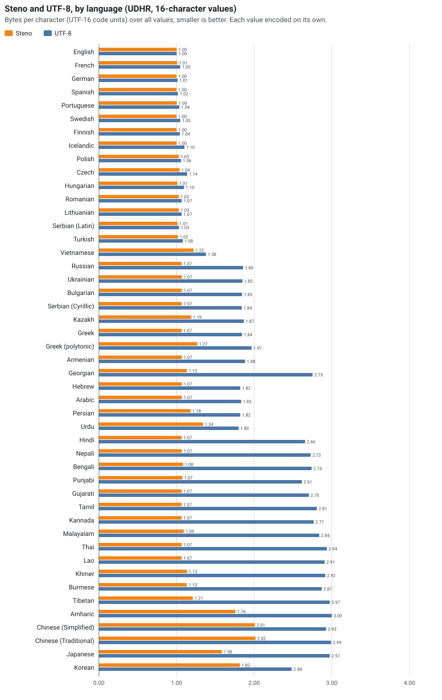

## Size, Head to Head

**Steno is smaller than UTF-8 over every one of the 13 groups of values (UTF-8 is 38% to 81% larger than Steno), and in 545 of the 565 sets of values; the two are tied (within 0.5%) in 20, and UTF-8 is smaller in none.**

A set of values is one language or text at one length of value, such as Russian in 16-character UDHR values; a group of values is all the sets of one length in one corpus. Bytes per character, counting characters as UTF-16 code units (an emoji counts as 2); smaller is better. Each value is encoded on its own, as a database stores a field.

By group of values:

| Group | **Steno** | UTF-8 | UTF-8 against Steno (+ is larger) |
|---|--:|--:|--:|
| UDHR, 4-char values | 1.26 | 1.97 | +56% |
| UDHR, 8-char values | 1.16 | 1.94 | +67% |
| UDHR, 16-char values | 1.11 | 1.92 | +73% |
| UDHR, paragraphs | 1.06 | 1.91 | +80% |
| UDHR, documents | 1.05 | 1.90 | +81% |
| Mixed content, lines | 1.17 | 1.66 | +42% |
| Mixed content, documents | 1.16 | 1.65 | +42% |
| Names and UI strings | 1.15 | 1.67 | +45% |
| Wikipedia, 4-char values | 1.18 | 1.63 | +38% |
| Wikipedia, 8-char values | 1.11 | 1.61 | +45% |
| Wikipedia, 16-char values | 1.08 | 1.60 | +48% |
| Wikipedia, paragraphs | 1.04 | 1.59 | +52% |
| Wikipedia, articles | 1.04 | 1.58 | +52% |

By script, over the UDHR in 47 languages:

| Script | **Steno**, 4 chars | UTF-8, 4 chars | UTF-8 against Steno, 4 chars | **Steno**, 16 chars | UTF-8, 16 chars | UTF-8 against Steno, 16 chars |
|---|--:|--:|--:|--:|--:|--:|
| Latin | 1.01 | 1.06 | +5% | 1.01 | 1.06 | +4% |
| Vietnamese | 1.32 | 1.42 | +8% | 1.22 | 1.38 | +13% |
| Cyrillic | 1.29 | 1.90 | +47% | 1.09 | 1.85 | +70% |
| Greek | 1.27 | 1.90 | +49% | 1.07 | 1.84 | +73% |
| Greek (polytonic) | 1.53 | 2.03 | +32% | 1.27 | 1.97 | +55% |
| Armenian | 1.27 | 1.92 | +52% | 1.07 | 1.88 | +76% |
| Georgian | 1.53 | 2.83 | +85% | 1.13 | 2.75 | +143% |
| Hebrew | 1.27 | 1.88 | +47% | 1.07 | 1.82 | +70% |
| Arabic script | 1.41 | 1.88 | +34% | 1.21 | 1.82 | +50% |
| Indic scripts | 1.28 | 2.83 | +122% | 1.07 | 2.73 | +155% |
| Thai and Lao | 1.25 | 2.94 | +135% | 1.07 | 2.92 | +174% |
| Khmer | 1.52 | 2.95 | +94% | 1.13 | 2.92 | +157% |
| Burmese | 1.52 | 2.92 | +92% | 1.13 | 2.87 | +154% |
| Tibetan | 1.59 | 2.98 | +87% | 1.21 | 2.97 | +146% |
| Ethiopic (Amharic) | 2.02 | 3.00 | +49% | 1.76 | 3.00 | +71% |
| Chinese | 2.21 | 2.96 | +34% | 2.01 | 2.96 | +47% |
| Japanese | 1.94 | 2.97 | +53% | 1.58 | 2.97 | +88% |
| Korean | 2.10 | 2.63 | +25% | 1.82 | 2.48 | +37% |

### Where UTF-8 Is Smaller

UTF-8 is not smaller than Steno, by 0.5% or more, in any set of values.

## Values per 8 KB Page

How many 16-character values fit in 8 KB, by script, over the UDHR in 47 languages; more is better. Calculated from the measured sizes ([how](../articles/benchmarks/machine.md#derived-figures)).

| Script | **Steno** | UTF-8 | Steno fits more (+) or fewer (−) |
|---|--:|--:|--:|
| Latin | 544 | 522 | +4% |
| Vietnamese | 461 | 408 | +13% |
| Cyrillic | 507 | 299 | +70% |
| Greek | 518 | 299 | +73% |
| Greek (polytonic) | 434 | 280 | +55% |
| Armenian | 518 | 293 | +77% |
| Georgian | 483 | 199 | +143% |
| Hebrew | 536 | 314 | +71% |
| Arabic script | 465 | 310 | +50% |
| Indic scripts | 513 | 201 | +155% |
| Thai and Lao | 515 | 188 | +174% |
| Khmer | 483 | 188 | +157% |
| Burmese | 476 | 187 | +155% |
| Tibetan | 448 | 182 | +146% |
| Ethiopic (Amharic) | 328 | 192 | +71% |
| Chinese | 332 | 226 | +47% |
| Japanese | 387 | 206 | +88% |
| Korean | 338 | 247 | +37% |
